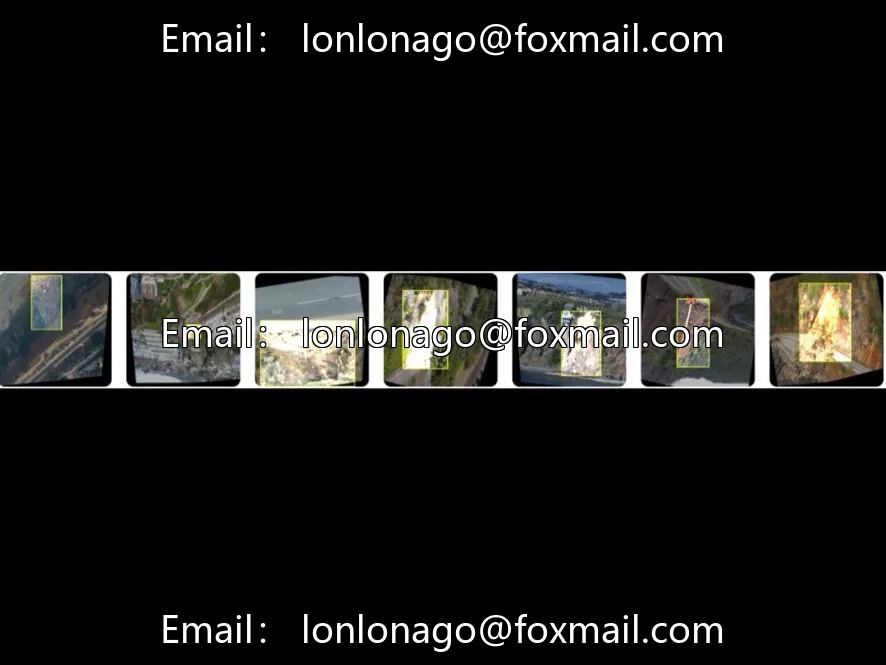
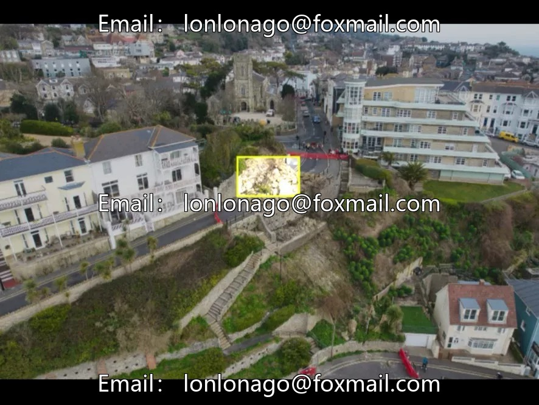
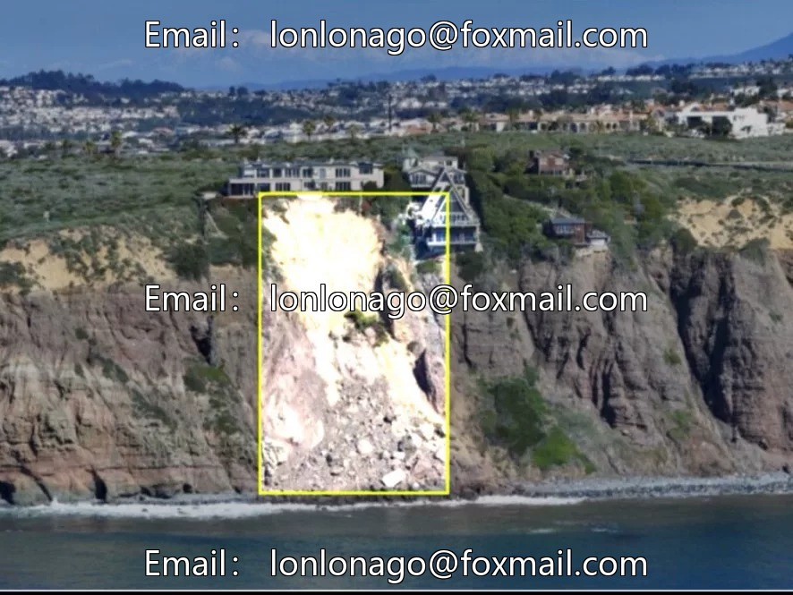
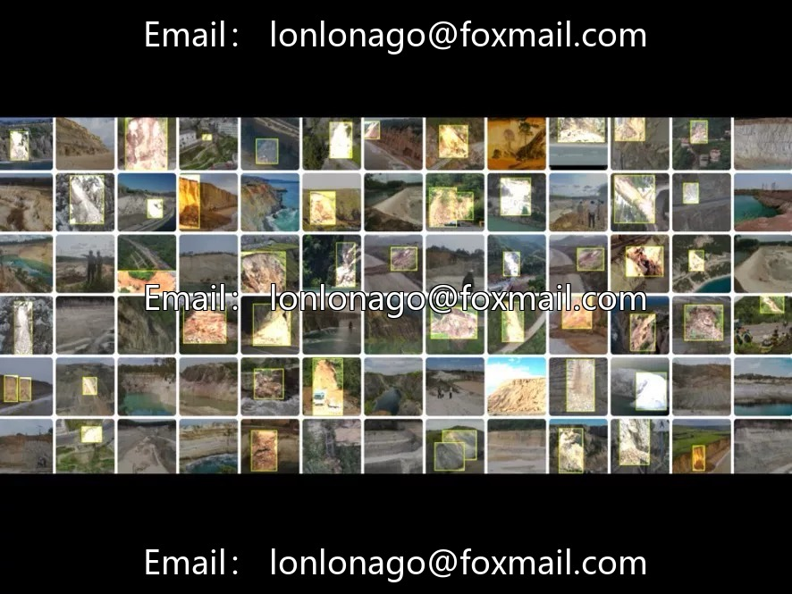

# UAV Slope and Landslide Detection Dataset (Issue 10670)

## Body

UAV Slope and Landslide Detection Dataset (Issue 10670)

The dataset contains 974 aerial imagery of drones, focusing on the "landslide" single-class target, suitable for slope inspection, geological disaster monitoring, emergency response and other scenarios. Marked in YOLO format, directly adaptable to mainstream frameworks such as YOLOv8/v11, convenient for use. The dataset is moderate in size, suitable for rapid validation and edge deployment. It is recommended to split the training/validation/test set at a ratio of 8:1:1 to enhance the model's generalization capability.

## Images

## Payment

Here is a pay link on Stripe ( https://buy.stripe.com/3cs8yP7sY87d0vu9AB ). Please contact me lonlonago@foxmail.com after funding $89, and I will send you a complete data files , thank you!

